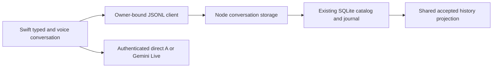

# Local conversation storage service

Swift launches one bundled Node process through `AgentRuntimeProcess`. It is a small storage service for the existing Chat catalog and canonical conversation journal. It does not call models, execute tools, run Pi, delegate work or start child agents. The old `agent/` directory and `heyintentive-agent.sqlite3` filename remain to preserve the existing database and packaging location.

## Admission and identity

The process requires an owner ID and state directory at startup. The strict version-2 protocol accepts only fixed catalog and journal operations, checks each request's owner, validates allowed surfaces and limits input size. It accepts no provider credentials, arbitrary query, execution or tool method. Account transition tears down the prior process through Swift's owner boundary; a message cannot change the storage owner's identity.

A conversation ID is separate from a provider connection and an utterance ID. Writes carry the current conversation generation. Clearing advances that generation, so a delayed result cannot restore cleared content. Existing tombstones, owner checks, transaction boundaries and idempotent identities remain in the retained storage implementation.

## Ordered history and delivery

`recordOrReviseExchange` accepts an assistant-only proactive exchange or a user/assistant pair. Revisions retain the turn's role and origin; foreign execution-owned rows cannot be rewritten as new direct conversation output. The canonical tail returns the latest revision of each logical turn in its original admission order, including equal-timestamp user/assistant pairs.

Swift waits for initial canonical admission before showing or playing the response. Later terminal updates describe what was actually completed, interrupted, failed or not spoken; a final journal acknowledgement is separate from the physical playback boundary. Journal-change wakes refresh the shared Home/floating projection, rather than introducing another conversation database.

Live pending/streaming turns are protected by a process-local active-turn set. Restart loses that set intentionally, allowing the retained orphan-repair operation to terminalize abandoned work. Historic schema, old artifacts and referenced attachment content stay decodable and owner-authorized; their presence does not reactivate execution.

## Extension and verification

Extend the narrow storage protocol and owner/generation transaction seam together. `conversation-entry`, `conversation-protocol` and `conversation-storage` tests cover startup and rejection, historical reopen, owner isolation, idempotency, generation fences, ordering and repair. Run the package build before tests because the stdio test consumes the generated entrypoint. Its only production npm dependency is `zod`; SQLite uses the existing Node store.

See [Chat and voice](../workflows/chat-voice.md), [local archive](local-data.md) and [account export](../workflows/account-lifecycle.md) for the surrounding owners.

## Source evidence

- [Process entry](../../../desktop/macos/agent/src/index.ts)
- [Protocol](../../../desktop/macos/agent/src/conversation-protocol.ts)
- [Storage](../../../desktop/macos/agent/src/conversation-storage.ts)
- [Retained journal](../../../desktop/macos/agent/src/runtime/conversation-journal.ts)
- [Storage regressions](../../../desktop/macos/agent/tests/conversation-storage.test.ts)
- [Swift process owner](../../../desktop/macos/Desktop/Sources/Chat/AgentRuntimeProcess.swift)

[Start here](../../quickstart.md) · [Authored guidance](../../INSTRUCTIONS.md)
