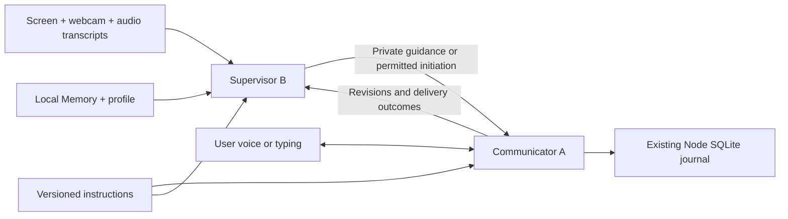

# System architecture

Intentive has two cooperating models. B observes permitted context and returns private guidance. A conducts the user's spoken or typed conversation. The Mac owns input permissions, conversation lifecycle, audio and local product data; the backend supplies authenticated compute and versioned instructions. Node retains only the existing conversation catalog/journal.

## Authority map

| Concern | Durable owner | Compute or presentation |
| --- | --- | --- |
| Transcripts and ambient conversation archive | Mac GRDB stores | Local Parakeet or transient cloud STT |
| Memory lifecycle, vectors and profile | Mac component stores | Backend proposals; local validation and commit |
| Typed/voice identity and accepted turns | Existing Node SQLite journal | Swift surfaces; native Live or direct Gemini A |
| Historical Tasks/goals/Insights/Focus | Retained owner-local tables | Decoding, references and authorized exports; active features retired |
| Account, usage, entitlements and updates | Backend control-plane stores | Authenticated clients and delivery workflows |

Provider failure does not authorize reloading product records from a retired hosted store. Account and generation checks fence delayed work at both Mac and Node boundaries. There is no Pi process, general tool loop or delegation path.

## One logical conversation

User shortcut and permitted B initiation enter the same conversation owner. A stays open across ordinary replies and focus changes. Automatic voice detection and shared voice-processing audio support spoken interruption; bounded Live recovery can move the same conversation into sticky batch STT → direct A → TTS fallback. Typed replies join that owner and retain its prompt receipt and canonical history.

Both initiators reveal the original notch and floating conversation surface. A read-only presentation snapshot connects opening and thinking to the retained blue glow, listening to processed microphone levels, and playback feedback to rendered output. The surface stays visibly open between replies; explicit hide or snooze ends the active conversation. Removing execution capabilities does not remove this interface. See [chat and voice](../workflows/chat-voice.md) for visual and meter ownership.

Initial journal admission precedes visible or audible output. Later speech delivery metadata distinguishes completed, interrupted, failed and unspoken results; playback completion and final persistence acknowledgement are separate boundaries. No second conversation database is introduced.

## Observation and behavior

B combines independent screen/webcam images, microphone/system transcripts, A conversation revisions and bounded existing Memory/profile. Its one-request scheduler coalesces changes, reconsiders quiet context with fresh images, and shares one token bucket across both triggers. Observation refresh does not multiply Rewind archive/OCR writes. Guidance expires and is invalidated on relevant context/account changes; active conversations receive it privately at an idle boundary.

Langfuse supplies instructions: A is pinned per logical conversation and B per evaluation. Code owns lifecycle, permissions, quotas and schemas. Private guidance and images never enter history or observability exports. Retained summary, Memory extraction, consolidation, embeddings and profile generation continue; action-item producers and retired feature UI do not.

## Read by task

- [Capture and transcription](../workflows/capture-transcription.md): audio becomes a local conversation.
- [Chat and voice](../workflows/chat-voice.md): one conversation carries typed and spoken exchanges.
- [Memory](../workflows/memory.md): proposals become durable local assertions.
- [Account lifecycle](../workflows/account-lifecycle.md): export and deletion cross different owners.
- [Delivery](../operations/releases.md): exact source becomes a qualified artifact or deployment.

Before changing capture, metering, playback or voice recovery, read the [authored runtime reliability boundaries](../../INSTRUCTIONS.md#runtime-reliability-boundaries). They preserve the required model routing, threading, delivery, acknowledgement and recovery rules.

[Provenance and product constraints](../../INSTRUCTIONS.md#provenance-and-ownership) are authored decisions. Inherited Windows sources are excluded from this active-product wiki. Source code proves implementation, not production readiness; open qualification obligations remain in the brief.

## Source evidence

- [backend/main.py](../../../backend/main.py#L95-L119)
- [desktop/macos/Desktop/Sources/Rewind/Core/MemoryStorage.swift](../../../desktop/macos/Desktop/Sources/Rewind/Core/MemoryStorage.swift)
- [backend/routers/memory_compute.py](../../../backend/routers/memory_compute.py)
- [Conversation owner](../../../desktop/macos/Desktop/Sources/FloatingControlBar/ConversationVoiceController.swift)
- [Direct A](../../../backend/routers/desktop_conversation.py)
- [desktop/macos/agent/src/runtime/conversation-journal.ts](../../../desktop/macos/agent/src/runtime/conversation-journal.ts)

[Start here](../../quickstart.md) · [Authored guidance](../../INSTRUCTIONS.md)
