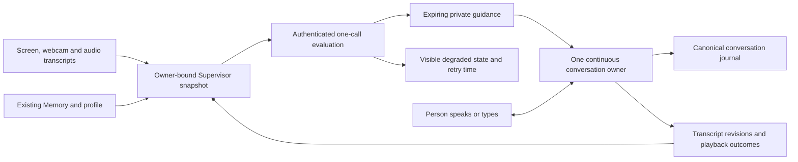

# Supervisor conversation

B observes permitted inputs and returns private guidance. A owns the conversation with the person: either the shortcut or B can open it, and replies continue without another shortcut press. Langfuse supplies instructions; the application supplies bounded inputs, lifecycle, transport and storage. The [authored product decision](../../INSTRUCTIONS.md#product-constraints) defines this scope.

## Independent, bounded observation

`SupervisorService` binds observations to the current account, capture session and context epochs. It retains the latest permitted screen and webcam images, up to 24 recent ambient segments, and up to 16 direct-conversation entries. Each evaluation reads at most twenty existing Memories, bounded to 1,000 characters each, and an 8,000-character profile. These are reads of retained context, not new profile generation.

Webcam is independently opt-in and uses AVFoundation. It retains one frame in memory, with a one-frame-per-second sampling limit, a 640-pixel long edge and a 256 KB JPEG cap. Frames older than five seconds are omitted. Screen images retain the 2 MB decoded cap; the entire request has a 4 MB cap. Input availability, capture times, image identities and active conversation state travel separately. Camera denial does not disable other permitted inputs. Lock, sleep, account changes and revoked capture authority clear invalid observations and guidance.

The capture plugin separates Supervisor freshness requests from Rewind archival work. A quiet person reading an unchanged screen remains observable beyond the archival idle threshold. Periodic Supervisor captures do not create extra archive frames or OCR writes. App/window and relevant screen/privacy changes invalidate old observations; ordinary capture age is not confused with a content revision.

Ambient transcript corrections replace entries by session, producer and segment identity. Direct voice capture/playback intervals exclude overlapping or unmappable ambient segments from B. Ordinary transcript persistence remains independent. A's partial transcript revisions and terminal playback outcomes update the same bounded direct-conversation entries. See [capture and transcription](capture-transcription.md).

## Adaptive admission

Local observation can sample once per second. A meaningful change establishes a one-second coalescing deadline from the first change; continued changes cannot indefinitely postpone it. Quiet context is reconsidered after thirty seconds with fresh permitted images. Both paths consume the same token bucket: capacity three, refilling one token every five seconds.

Only one inference request can be in flight. New input replaces the pending snapshot instead of creating a backlog. Content revision, capture age, request admission time and guidance expiry are separate. Guidance expires thirty seconds after admission, including context-loading and inference time. Account, capture-session and relevant-context checks fence asynchronous results before delivery. Opening A does not itself invalidate the cue that opened it.

The read-only nonproduction diagnostic snapshot records session-scoped admissions, budget deferrals, fixed-reason skips, evaluator starts/returns/failures and constant-size timing aggregates. It also projects permitted input age, pending work, budget and retry state without exposing image/transcript/guidance content or the process-wide content revision. Ending a session resets counters and rejects old completion receipts. Evaluator round-trip includes network/backend time; provider-only latency and exclusive token counts come from backend telemetry. Development has a separately configured B allowance of 6,000 requests per day; the hosted limit remains 1,500. These are implementation defaults, not measured production cost ceilings.

## Private decisions and delivery

`POST /v1/supervisor/evaluate` authenticates the account, resolves B's managed instructions and makes one schema-constrained Gemini 3.8 Flash call with low thinking and no tools. The result is `wait`, `guide_next_turn` or `intervene`. Invalid output or unavailable instructions produces a degraded wait result. Guidance is bounded, expiring and correlated with its admitted observation and context.

| Conversation state | Delivery |
| --- | --- |
| Closed | `intervene` may open A, subject to explicit user controls and current authority. |
| Open with Live | Queue the cue during generation/playback; append privately at an idle boundary with `clientContent` and `turnComplete: false`. |
| Open with typed or fallback A | Supply eligible guidance privately to the next admitted response, under the same conversation lease. |

A cue is never a user message. It cannot start a competing answer, and acknowledgement consumes it once. The private note is capped at 2,000 characters and permitted accompanying context at 4,000. Stale or cross-account cues are rejected. The Live transport serializes silent append against generation; source and fake-provider tests do not establish that the actual provider accepts this behavior.

Provider failures record a correlated degraded observation and return safe error categories without raw provider bodies. B exposes a paused state and retry time. A quota retry/reset time controls resumption; other failures default to a sixty-second pause. Pauses survive capture toggles and lock/unlock for the same owner, and resumed evaluations use fresh observations rather than replaying old guidance.

## One conversation and actual outcomes

Both proactive and user initiation use `ConversationVoiceController`. Live keeps automatic voice activity detection active between exchanges. Spoken interruption flushes output and rejects obsolete generation callbacks. B receives accepted transcript revisions plus completed, interrupted or failed playback outcomes. Continuous fallback retains the same conversation and pinned A instructions. See [chat and voice](chat-voice.md).

Both initiators reveal the same original notch and floating conversation panel. The shared opening path cancels stale dismissals and preserves saved visibility, while B retains background snooze restrictions. Lifecycle state drives the retained opening glow and thinking feedback; actual microphone and rendered-playback levels drive their visual feedback. The panel stays visibly open between replies and on focus loss. Explicit hide/snooze ends the active conversation before hiding its input indicator.

Proactive speech creates assistant-only canonical journal entries. Persistence acceptance and actual delivery are separate: output waits for journal admission, while full delivery requires provider completion and playback drain. Interruption records its outcome without making the next utterance wait for journal acknowledgement. The existing Node/SQLite journal remains the single conversation history.

Evaluation sharing starts off and is scoped to the current session. Consent epochs and account checks after token lookup prevent queued text from escaping after revocation. Optional bounded conversation examples never include private B notes or image bytes. Operational telemetry records allowlisted metadata, prompt receipts and token usage. See [telemetry](../integrations/telemetry.md).

## Verification boundary

Tests cover scheduling, budget sharing, scoped cues, transcript replacement, capture isolation, private provider requests and canonical delivery outcomes. The [manual conversation flow](../../../desktop/macos/e2e/flows/supervisor-conversation.yaml) additionally requires human-heard speech and natural interruption on speakers, headphones and a supported Bluetooth route. A provider protocol probe, an app launch and a fake-clock workday are distinct from physical audio acceptance and an eight-hour resource soak. The [authored initial launch scope](../../INSTRUCTIONS.md#product-constraints) starts with one real owner pilot; the extended device matrix and soak remain unperformed qualifications rather than additional gates for that short pilot.

[Start here](../../quickstart.md) · [Authored guidance](../../INSTRUCTIONS.md)
